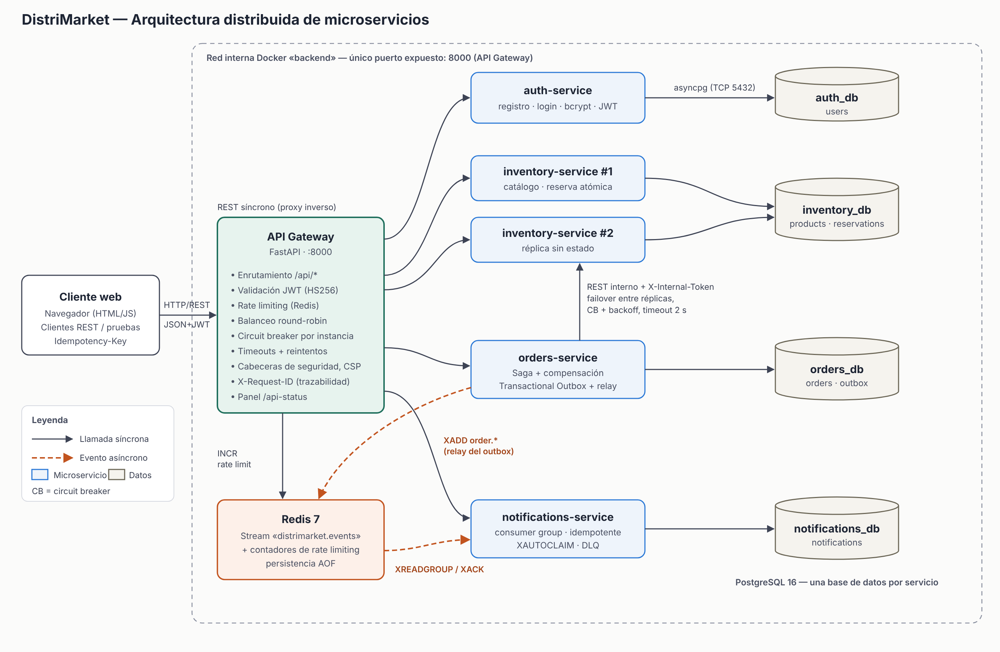

# DistriMarket — Plataforma distribuida de pedidos

Proyecto final de **Sistemas Distribuidos**. Sistema de pedidos en línea para pequeños comercios
construido con **microservicios**, comunicación **síncrona (REST)** y **asíncrona (eventos en
Redis Streams)**, **tolerancia a fallos** (réplicas, circuit breaker, reintentos, outbox, consumer
groups) y **seguridad** (JWT, bcrypt, rate limiting, autorización por rol y por objeto).



---

## 1. Componentes

| Servicio | Puerto local | Responsabilidad | Base de datos |
|---|---|---|---|
| `gateway` | **8000** (único expuesto) | Enrutamiento, JWT, rate limiting, balanceo, circuit breaker, cliente web | — |
| `auth` | 8001 | Registro, login, emisión de JWT (bcrypt) | `auth_db` |
| `inventory-1`, `inventory-2` | 8002, 8012 | Catálogo y reserva atómica e idempotente de stock (2 réplicas) | `inventory_db` |
| `orders` | 8003 | Pedidos, Saga con compensación, Transactional Outbox | `orders_db` |
| `notifications` | 8004 | Consumidor de eventos (consumer group), notificaciones | `notifications_db` |
| `postgres` | 5432 | PostgreSQL 16 (una BD por servicio) | — |
| `redis` | 6379 | Broker de eventos (Streams) + contadores de rate limiting | — |

## 2. Estructura del repositorio

```
distrimarket/
├── common/                 # Código compartido: seguridad JWT, circuit breaker, reintentos, logging JSON, BD
├── services/
│   ├── gateway/main.py     # API Gateway
│   ├── auth/main.py        # Autenticación
│   ├── inventory/main.py   # Inventario (réplicas)
│   ├── orders/main.py      # Pedidos + outbox
│   └── notifications/main.py
├── frontend/               # Cliente web (HTML/CSS/JS, servido por el gateway)
├── tests/                  # Pruebas funcionales, integración y concurrencia (pytest)
├── scripts/
│   ├── stack.sh            # Ejecución local sin Docker (start/stop/status por servicio)
│   ├── load_test.py        # Pruebas de rendimiento
│   ├── fault_tests.py      # Pruebas de tolerancia a fallos (inyección de fallos)
│   ├── charts.py           # Gráficas de resultados
│   └── screenshots.py      # Capturas automáticas del cliente web
├── deploy/init-db.sql      # Creación de las 4 bases de datos
├── docs/                   # Diagrama de arquitectura, evidencias de pruebas, guion del video
├── Dockerfile              # Imagen única parametrizada (ARG SERVICE)
├── docker-compose.yml
├── requirements.txt
└── .env.example
```

---

## 3. Manual de instalación y ejecución

### 3.1 Requisitos

**Hardware mínimo:** 2 vCPU, 4 GB de RAM, 3 GB de disco.
**Software (opción A, recomendada):** Docker Engine 24+ con Docker Compose v2.
**Software (opción B, sin Docker):** Python 3.12+ (probado en 3.13), PostgreSQL 16, Redis 7, `curl`.

### 3.2 Opción A — Docker Compose (recomendada)

```bash
git clone <URL-del-repositorio> distrimarket && cd distrimarket
cp .env.example .env
# Edite .env y genere secretos:  openssl rand -hex 32
docker compose up -d --build
docker compose ps          # todos los servicios deben quedar "healthy"/"running"
```

Abra **http://localhost:8000** — usuario administrador: `admin@distrimarket.co` / valor de
`ADMIN_PASSWORD`. Cree un usuario cliente desde «Crear cuenta».

Simular fallos con Docker:

```bash
docker compose stop inventory-1        # el catálogo y los pedidos siguen funcionando (réplica 2)
docker compose stop notifications      # los pedidos siguen; los eventos esperan en Redis
docker compose start notifications     # se procesan los eventos pendientes
docker compose logs -f orders          # logs JSON con request_id
```

### 3.3 Opción B — Ejecución local sin Docker

```bash
pip install -r requirements.txt
# PostgreSQL: usuario dm / clave dm, y las 4 bases de datos:
psql -U postgres -c "CREATE USER dm WITH PASSWORD 'dm' CREATEDB;"
psql -U dm -d postgres -f deploy/init-db.sql
redis-server --daemonize yes --appendonly yes
scripts/stack.sh start        # levanta los 6 procesos
scripts/stack.sh status
scripts/stack.sh stop inventory-1   # inyectar un fallo
```

### 3.4 Variables de configuración

| Variable | Descripción | Valor por defecto |
|---|---|---|
| `JWT_SECRET` | Clave HMAC para firmar los JWT (≥ 32 bytes) | **obligatoria** en Docker |
| `INTERNAL_TOKEN` | Token compartido para llamadas servicio-a-servicio | **obligatoria** en Docker |
| `JWT_TTL_MINUTES` | Vigencia del token | 60 |
| `DATABASE_URL` | Cadena de conexión PostgreSQL de cada servicio | ver compose |
| `REDIS_URL` | Broker de eventos y rate limiting | `redis://redis:6379/0` |
| `INVENTORY_URLS` | Réplicas de inventario (separadas por coma) | `inventory-1`, `inventory-2` |
| `RATE_LIMIT_PER_MIN` | Peticiones por IP por minuto (global) | 600 |
| `LOGIN_RATE_LIMIT_PER_MIN` | Intentos de login **fallidos** por IP por minuto | 10 |
| `ADMIN_EMAIL` / `ADMIN_PASSWORD` | Administrador inicial | ver `.env.example` |
| `WORKERS` | Procesos uvicorn por contenedor | 2 |

### 3.5 Ejecutar las pruebas

```bash
cd tests && JWT_SECRET=<el-mismo-del-sistema> pytest -v        # 36 pruebas
python scripts/load_test.py --duration 15                      # rendimiento
python scripts/fault_tests.py                                  # 7 escenarios de fallo (modo local)
python scripts/charts.py                                       # gráficas en docs/evidencias
```

## 4. API (a través del gateway)

| Método | Ruta | Auth | Descripción |
|---|---|---|---|
| POST | `/api/auth/register` | — | Registrar cliente |
| POST | `/api/auth/login` | — | Obtener JWT |
| GET | `/api/auth/me` | JWT | Datos del token |
| GET | `/api/products` · `/api/products/{id}` | — | Catálogo |
| POST | `/api/products` | JWT admin | Crear producto |
| PATCH | `/api/products/{id}/stock` | JWT admin | Ajustar stock |
| POST | `/api/orders` | JWT (+ `Idempotency-Key` opcional) | Crear pedido |
| GET | `/api/orders` · `/api/orders/{id}` | JWT | Mis pedidos |
| POST | `/api/orders/{id}/cancel` | JWT | Cancelar (libera stock) |
| GET | `/api/notifications` | JWT | Mis notificaciones |
| GET | `/api-status` | — | Salud de instancias y circuit breakers |

Ejemplo:

```bash
TOKEN=$(curl -s -X POST localhost:8000/api/auth/login -H 'Content-Type: application/json' \
  -d '{"email":"admin@distrimarket.co","password":"Admin#2026seguro"}' | python3 -c 'import sys,json;print(json.load(sys.stdin)["access_token"])')
curl -s -X POST localhost:8000/api/orders -H "Authorization: Bearer $TOKEN" \
  -H 'Content-Type: application/json' -H "Idempotency-Key: $(uuidgen)" \
  -d '{"items":[{"product_id":1,"quantity":2}]}'
```

## 5. Resultados de pruebas (resumen)

* **36/36** pruebas funcionales, de integración y de concurrencia superadas.
* **0 sobreventas** con 100 compras simultáneas sobre 25 unidades (exactamente 25 éxitos).
* **7/7** escenarios de tolerancia a fallos superados (caída de réplicas, de todo el inventario,
  del broker, del consumidor, de pedidos).
* Rendimiento con 10 usuarios concurrentes: **437 req/s** en catálogo (p95 33 ms) y **196
  pedidos/s** (p95 73 ms), 100 % de éxito en todos los niveles de carga.

Detalle en `docs/evidencias/`.
